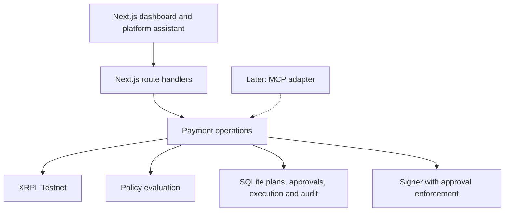

# Platform-first build plan

Build the Archipelago web platform first. Keep its payment operations callable through small server functions so a later MCP integration can use the same implementation.

## Current starting point

- Framework, environment examples, and the Testnet connection check are set up; [#12](https://github.com/josweon/archipelago/issues/12) is closed.
- The current homepage is Scaffold-XRP's wallet/account/payment starter. The merchant dashboard, guarded payment workflow, batch importer, and agent are planned work.
- Use Next.js/React, TypeScript, the existing XRPL client, and SQLite for the initial platform.
- First release scope: XRPL Testnet, simulated BankNY-USD and BankSG-SGD issuers, and direct or XRP-bridge payment routes.

## First working demo

From the platform, a user prepares one USD-to-SGD payment, compares live route quotes, sees the policy result, approves the exact payment, and submits it. The result includes ledger validation status, an explorer link, and a verifiable audit record.

Build this vertical slice before adding batch orchestration. A live quote and validated transaction must be distinguishable from fixtures and an unvalidated submission.

## Implementation boundary



Put payment logic in server-side modules, with route handlers translating HTTP requests into calls. React components display data and request actions. The server owns authoritative plans, quotes, approvals, and execution state.

Suggested directories, to create as each feature is implemented:

```text
apps/web/
  app/api/                 HTTP endpoints for the platform
  components/dashboard/    Map, routes, policy, approval and audit views
  lib/contracts/           Shared TypeScript types and runtime validation
  lib/server/ledger/       Ledger reads, connection handling and seed/reset
  lib/server/payments/     Plan creation, quotes and execution orchestration
  lib/server/policy/       YAML configuration and deterministic checks
  lib/server/audit/        SQLite records and memo hash verification
  lib/server/agent/        Swappable model adapter and platform tool loop
```

Use Next.js's server-only boundary for server modules. Keep signing keys and model credentials in server configuration. Shared contracts must be safe to import in the browser.

## Operations to agree on before parallel implementation

These are proposed interfaces, not endpoints already implemented. HTTP handlers and a later MCP adapter should translate into these operations.

| Operation | Responsibility |
| --- | --- |
| `getIslandMap()` | Return ledger-backed accounts, assets, trust-line connections, and the observed ledger index. |
| `createPaymentPlan(input)` | Validate proposed payment rows and persist a versioned draft with source references. |
| `findRoutes({ planId })` | Calculate candidate routes and persist quotes for that plan version. |
| `preflight({ planId })` | Evaluate policy and return `approve`, `block`, or `needs_human`, with reason codes per payment. |
| `approvePlan({ planId, version })` | Record an authenticated human's approval of the displayed plan and limits. The server derives the approver identity. |
| `requestExecution({ planId, approvalId, idempotencyKey })` | Recheck current conditions, enforce the recorded approval, and execute eligible payments. |
| `getPaymentPlan({ planId })` | Return authoritative plan, quote, approval, execution, and audit status. |

The platform assistant can use the map, route, preflight, execution-request, and plan-read operations. Human approval is recorded through the authenticated review flow. An assistant supplying `approved: true` does not constitute approval.

The later visual tool, `render_payment_plan(plan_id)`, should read a stored plan and render its data. The platform can build the same route component now; rendering does not create or change payments.

### Shared data conventions

- Represent amounts as decimal strings, with explicit currency and issuer for issued assets. Use exact decimal arithmetic or integer units for calculations.
- Give every plan a stable ID and version, and every payment a stable ID and source reference.
- Include source, destination, source amount or requested destination amount, and both asset identities. Explicitly distinguish source-specified and destination-specified payments.
- Quotes include the route, expected amounts, fee estimates, slippage, ledger index, and expiry. A batch total must be grouped by currency and issuer.
- Preserve source evidence, such as CSV row or report page, so users can inspect an extracted payment.
- Return structured errors and reason codes usable by both UI and agents.

## Build order and completion gates

### Milestone 1: One guarded payment through the platform

1. **Seed the ledger:** implement the deterministic Testnet setup in [#13](https://github.com/josweon/archipelago/issues/13), with the recovery checks in [#24](https://github.com/josweon/archipelago/issues/24).
2. **Quote a payment:** implement the map and route finder in [#14](https://github.com/josweon/archipelago/issues/14). Support a direct candidate and an XRP-bridge candidate when liquidity permits; report unavailable routes clearly.
3. **Evaluate policy:** implement [#16](https://github.com/josweon/archipelago/issues/16) using the configuration from [#23](https://github.com/josweon/archipelago/issues/23).
4. **Approve and execute:** combine the executor in [#15](https://github.com/josweon/archipelago/issues/15) and signer/audit recorder in [#17](https://github.com/josweon/archipelago/issues/17). Persist plan and approval state before enabling execution from the UI.
5. **Review the result:** connect dashboard [#21](https://github.com/josweon/archipelago/issues/21) and audit view [#22](https://github.com/josweon/archipelago/issues/22) to the same stored plan.

Completion gate: a user can prepare, quote, inspect, approve, execute, and verify one payment from the platform. A blocked payment cannot reach the signer. Complete the adversarial, key-handling, and round-trip checks in [#25](https://github.com/josweon/archipelago/issues/25), [#20](https://github.com/josweon/archipelago/issues/20), and [#26](https://github.com/josweon/archipelago/issues/26).

### Milestone 2: Merchant batch import and review

Start with a defined CSV format; an [example input](examples/payment-batch.csv) is included. Its placeholder addresses must be replaced with the accounts and issuer addresses produced by the seed script before submission.

- Import rows into a draft plan, validate addresses/assets/amounts, and flag duplicate source references.
- Show row evidence, candidate routes, policy decisions, currency totals, and exceptions in one review screen.
- Quote and execute with the batch's shared liquidity and balance constraints in mind. Independent quotes may compete for the same liquidity.
- Persist an execution record per payment. Duplicate requests must return the existing result instead of paying again.
- Represent partial success explicitly: validated, submitted/pending, failed, or not attempted. Reconcile uncertain submission outcomes before allowing retries.
- Bind human approval to the plan version, recipients, amounts, selected routes, permitted fees/slippage, and expiry. Edits invalidate approval; changed quotes outside approved bounds require renewed review.

Completion gate: a small batch containing a valid row, an invalid row, and a repeated request is handled correctly. The user sees exceptions before approval, and retries do not duplicate successful payments.

Batch-specific acceptance criteria extend the existing single-payment issues and should be tracked as follow-up work. They have not been added to GitHub by this document.

### Milestone 3: Agent inside the platform

Implement the swappable model/tool interface in [#18](https://github.com/josweon/archipelago/issues/18) after the payment operations work independently.

- Add an assistant to the platform that can interpret a supported report and create a draft payment plan.
- Start with one documented report format and include source evidence for every extracted payment. Require clarification for missing recipient or amount information.
- Validate extracted fields through the same contracts as manual/CSV input. Report content is source data and cannot grant execution authority.
- Let the assistant request map data, quotes, and policy results, then display the existing review component.
- Process batch calculations in the backend. Keep model calls focused on interpreting input, coordinating the workflow, and answering user questions.
- Make the model adapter replaceable through server configuration. Provider-specific SDK calls stay inside that adapter.

Completion gate: a report can become a reviewed batch through the platform assistant, and the same authenticated approval and signer checks apply as in the manual flow. Model extraction failures leave a correctable draft rather than submitting payments.

### Later: Chat integrations

Expose the working operations through an authenticated MCP adapter. Add the route/plan component as a host-compatible UI resource and keep structured data available for clients without that UI capability. Verify each client's execution and publication rules before exposing payment submission there.

MCP packaging, host-specific widgets, and public plugin distribution belong to this later phase. They are not dependencies of the platform demo.

## Workstreams the team can start in parallel

Assign a person to each stream after agreeing on the contracts above. These are suggested roles, not changes to GitHub assignees.

| Stream | First deliverable | Existing issues / dependency |
| --- | --- | --- |
| Ledger and routing | Seed script, map snapshot, and quotes for one payment | #13, #14, #24; publishes fixtures matching the contracts |
| Policy, signing and audit | Policy result, persisted approval, guarded execution, audit hash | #16, #23, #15, #17, #20, #25; integrates with route output |
| Platform UI | Payment form, island map, route comparison, policy/review panel, audit tab | #21, #22; starts with explicitly labeled fixtures |
| API and integration | Plan lifecycle, SQLite persistence, authenticated approval, shared validation, end-to-end checks | API portion of #19, #26; defines contracts with all streams |

Add the model/tool loop from #18 once those streams produce a working vertical slice. The batch importer and report parser can then reuse the same plan lifecycle.

The first demo can query ledger state directly and refresh plan status through the platform API. Add the QuickNode receiver from #19 when live ingestion is needed. Earlier arbitrage workers, rebalancing tasks, and order-book dashboards are outside this payment demo's critical path.

## Immediate team handoff

1. Agree on the first seeded sender/recipient, asset issuers, and one payment example.
2. Assign the four workstreams and settle the shared contracts before separate implementations diverge.
3. Get one payment through the full platform, including approval and audit verification.
4. Add batch import, then the in-platform assistant, then the chat adapter.
